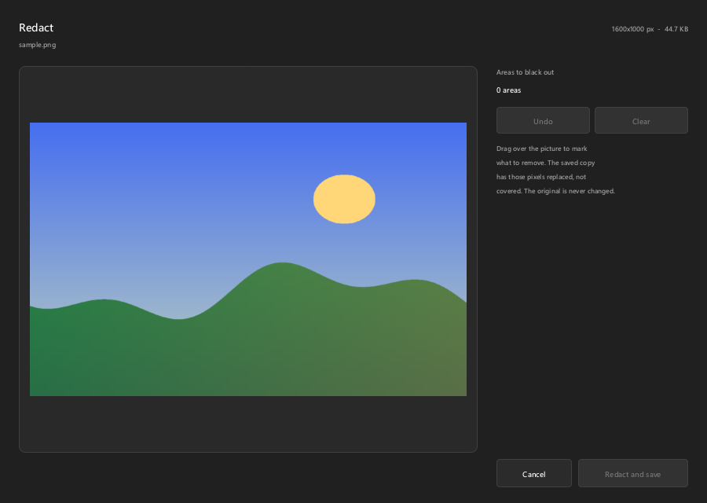

# Radial

Drag a file in Explorer, hold **Shift**, and a radial menu blooms under the cursor. Drop the file on a sector to
convert it, compress it, crop it, put it on a background, annotate it or black parts of it out. Written in Rust for
Windows 11: one 2.7 MB executable, no runtime, zero CPU while idle.

<p align="center">
  
  
  
</p>

## What it does

Every file you drag gets the same **three rings**. Radial looks inside the file (not just at its name) to decide which
one opens first and which sectors work.

| Ring | Sectors, clockwise from the top | Opens first for |
| --- | --- | --- |
| **1. Documents** | DOCX, JPG, PNG, TXT. The file's own format is replaced by PDF. | PDF, DOCX, text files, anything else |
| **2. Images** | PNG, WEBP, HEIC, TIFF, AVIF, BMP, PDF, DOCX. The file's own format is replaced by JPG, so there are always eight. | images (PNG, JPG, WEBP, GIF, TIFF, BMP, HEIC, AVIF) |
| **3. Actions** | COMPRESS, METADATA, EDIT, ANNOTATE, ADD BG, CROP, REDACT | (reached with the wheel, Tab or the hub) |

**Turn the mouse wheel while you drag** to move between the rings (down is next, up is previous; Tab and resting on
the hub also go to the next one). The pill under the ring shows three dots, the current ring, and what comes next.
The hub shows the file size, e.g. `1.1 MB`, or the format.

Results are written next to the original (or into your output folder) and **never overwrite anything** unless you
choose "Overwrite": `photo.png` becomes `photo (1).png`. Dragging several files converts all of them.

### Sectors that cannot work are shown, not hidden

A sector that cannot work for this file or this machine is greyed out, and hovering it says why in the pill under the
ring, for example `AVIF encoding needs ...` when Windows has no AV1 encoder, `Works on JPG, PNG, WEBP only` for
COMPRESS on a BMP, `Works on images only` for the actions of a PDF, or `Can't convert this file to that format` for a
picture to TXT. A file Radial does not read (a ZIP, a video...) still opens all three rings, with every sector greyed
out, so the menu never just fails to appear.
Nothing is faked: `radial --formats` prints exactly what your machine can read and write.

<p align="center"></p>

### The actions ring

The third ring has seven actions and works on images. Besides the wheel, press **Tab**, or move off the centre hub
and rest the pointer back on it for half a second (a ring fills around the hub while you wait), to go to the next
ring. The wheel always works; Settings picks whether Tab, the hub or both also do, and which ring a drag opens on.

| Sector | What happens |
| --- | --- |
| **COMPRESS** | Runs on drop. JPEG is re-encoded at quality 80, PNG (smaller palettes or colour types, maximum deflate) and WEBP are lossless. A file is only written when it is smaller; otherwise you are told it is already as small as it gets. The notice shows before and after sizes. |
| **METADATA** | Runs on drop. Removes EXIF (camera, GPS location), XMP, IPTC and text chunks and saves `name (clean).ext`. A picture without metadata writes nothing. JPG, PNG, WEBP, TIFF. |
| **EDIT** | Dialog: rotate, flip, resize (with or without keeping proportions), grayscale, brightness, contrast, with a live preview. |
| **ANNOTATE** | Dialog: pen, line, arrow, box, ellipse, marker, text; colour, size, undo. |
| **ADD BG** | Dialog "Add BG": ten gradients and colours, your own colour or a picture as background; sliders for Padding, Corners and Shadow; canvas ratio Auto, 1:1, 16:9, 4:5; "Save with background". |
| **CROP** | Dialog "Crop Image": ratio Free, 1:1, 16:9, 9:16, 4:3, 3:4; a rectangle you drag with eight handles; W and H in pixels. |
| **REDACT** | Dialog: drag rectangles over what must go. The saved copy has those pixels **replaced**, not covered, so they cannot be recovered; the original is never touched. |

The dialogs are drawn by the app itself (the same look as Settings, in your theme's accent, dark or light with the
system), keyboard friendly (**Tab** moves between controls, **Enter** applies, **Esc** closes, **Ctrl+Z** undoes in
ANNOTATE and REDACT), and DPI aware. They are created when you drop and every buffer is freed when they close. The
heavy work (decoding, previews, saving) runs on worker threads, so a large picture never freezes the window.

<p align="center">
  
  
  
  
  
</p>

## Looks

- **Real frosted glass.** The area behind the menu is captured when it opens, blurred, saturated and tinted, so the
  sectors look like glass over whatever is on your screen. Layered soft shadows, rim light, vector icons (nothing
  bundled, no emoji) and spring-driven motion with a staggered entrance, hover lift and a drop-confirmation pulse.
- **Looks like Windows.** The default theme, "Windows 11", is flat acrylic with the system accent colour and follows light or dark mode; the dialogs and Settings use the same neutrals, 4 px controls and Segoe UI.
- **Eight themes, and yours.** Windows 11, Obsidian Glass, Frosted Paper, Mono Ink, Aurora, Sunset, Terminal Neon and Noir Gold.
  A theme is a plain text file (see [Themes](#themes)).
- **A configurator with a live preview.** The first run starts a three step onboarding (pick a look, pick a key,
  done); afterwards it is one click away in the tray menu. Everything is adjustable: accent colour, size, ring
  thickness, gap, corner roundness, glass strength, animation speed, font, trigger key (Shift, Ctrl, Alt or none),
  open delay, output folder, what to do when the name is taken, sound or notification when done, how to switch rings,
  start with Windows, English or Spanish.


<p align="center">
  
  
</p>

## Formats

`radial --formats` prints this table for your machine. What each format needs:

| Format | Read | Write | How, and what to know |
| --- | --- | --- | --- |
| PNG, JPG, BMP, TIFF | yes | yes | Pure Rust. JPG output flattens transparency onto white. The EXIF orientation is applied when reading. |
| WEBP | yes | yes | Pure Rust, output is **lossless**. |
| GIF | yes | yes | First frame only: animations become a still picture. |
| HEIC | needs Windows | needs Windows | Through the Windows codec ("HEIF Image Extensions" from the Microsoft Store). Without it the sector is greyed out and says so. Write support is verified with a real test encode. |
| AVIF | needs Windows | **off by default** | Reading needs the Store's "AV1 Video Extension". Windows ships no AVIF encoder, so the sector is greyed out unless you build with `--features avif-encode` (pure-Rust rav1e, about +2.3 MB and slow on big pictures). |
| PDF as a source | yes | n/a | Rendered with the Windows PDF engine (`Windows.Data.Pdf`) for JPG and PNG (every page, `name-p1.png` ...), text taken from the PDF's text layer for TXT and DOCX, and Windows OCR for scanned pages. |
| PDF as a target | n/a | yes | Images are embedded as they are (JPEG stays JPEG); text files are laid out in a simple page format. |
| DOCX | yes | yes | Text, page breaks and pictures. Word opens the result; other editors were not tested. |
| TXT | yes | yes | UTF-8, UTF-16 with a BOM or Windows-1252 are detected. |

PDF caveats: password-protected PDFs are refused, PDFs whose fonts have no Unicode mapping give no text (use the OCR
route by converting to PNG first), and PDF to DOCX keeps the text, not the layout.

## Install

Download `radial.exe` (or the zip with the licence) from the releases page and run it. It lives in the tray (right
click for the menu). There is no installer; delete the file and `%APPDATA%\radial` to remove it.

### Build

```
cargo build --release
```

The binary is `target/release/radial.exe`. Fonts are read from the Windows fonts folder (Segoe UI Variable,
Bahnschrift, Consolas, Georgia), nothing is bundled. Optional: `cargo build --release --features avif-encode` adds an
AVIF encoder.

## Using it

1. Run `radial.exe`. On first run the onboarding opens.
2. Start dragging a file from Explorer or the desktop.
3. Hold the trigger key (Shift by default), move onto a sector and let go. Turn the **mouse wheel** (or press
   Tab, or rest on the centre) to move between the three rings.

Tray menu: **Settings...**, **Pause / Resume**, **Start with Windows**, **About**, **Quit**. Double click the tray
icon to open the settings.

Command line (all optional, for scripting, documentation and development):

| Flag | What it does |
| --- | --- |
| `--help`, `--version` | Prints usage or the version |
| `--formats` | Prints what this machine can read and write |
| `--open crop\|bg\|edit\|annotate\|redact <image>` | Opens one action dialog without the tray; the process ends when it closes |
| `--autostart on` / `--autostart off` | Adds or removes the start-with-Windows entry (`HKCU\...\Run`) and exits |
| `--preview out.png [--theme glass] [--hover 2] [--menu 8\|4\|7] [--accent #ff8800] [--dpi 2]` | Renders a menu over a sample wallpaper: 8 is the image ring, 4 the document ring, 7 the actions ring |
| `--sheet out.png` | Renders every theme into one contact sheet (this is how `docs/themes.png` is made) |
| `--settings out.png [--tab 1] [--step 0..2] [--lang es] [--light] [--menu 8\|4\|7]` | Renders the configurator window to a PNG |
| `--dialog crop\|bg\|edit\|annotate\|redact --out out.png [--image f] [--script s] [--lang es] [--light] [--dpi 2]` | Renders a dialog to a PNG; `--script "click:102;drag:200,300,420,230;text:Hi;key:13"` drives it first (this is how the `docs/dialog-*.png` are made) |
| `--tray-icon out.png [--size 256]` | Renders the icon at any size (the `.ico` is built from it) |
| `--bench [--theme x] [--dpi 1.2]` | Prints the time to bake and render a frame |

## Settings file

`%APPDATA%\radial\config` is a `key = value` text file the configurator rewrites; you can edit it by hand (unknown
keys and bad values are ignored, numbers are clamped).

| Key | Values | Default |
| --- | --- | --- |
| `theme` | a theme name | `glass` |
| `accent` | `auto` or `#rrggbb` | `auto` |
| `size` | 0.7 to 1.5 | `1` |
| `ring`, `gap`, `corner` | ring thickness 56 to 150, gap 0 to 24, corner 0 to 40 (logical px) | from the theme |
| `glass` | 0 (plain tint) to 1.5 (strong blur) | `1` |
| `speed` | animation speed 0.4 to 2.5 | `1` |
| `font` | `theme`, `variable`, `bahnschrift`, `consolas`, `georgia` | `theme` |
| `trigger` | `shift`, `ctrl`, `alt`, `none` | `shift` |
| `delay_ms` | 0 to 800, how long the drag is held before the menu opens | `0` |
| `ring_switch` | `both` (Tab or resting on the hub), `tab`, `hub`; the wheel always works | `both` |
| `start_ring` | `auto` (images on the image ring, the rest on documents), `documents`, `images` or `actions`: the ring a drag opens on | `auto` |
| `out_dir` | empty (next to the source) or a folder | empty |
| `collision` | `rename`, `overwrite`, `skip` | `rename` |
| `notify` | `off`, `balloon`, `sound`, `both` | `balloon` |
| `autostart` | `true` / `false` | `false` |
| `lang` | `en`, `es` | system language |

## Themes

A theme is a `key = value` file; every key is optional and defaults to the Obsidian Glass values. The built-in ones live in
[`assets/themes`](assets/themes) and are embedded in the binary. Your own go in `%APPDATA%\radial\themes\*.theme` and
show up in the configurator next to the built-in ones.

```
# my-theme.theme
name = my-theme            # lowercase letters, digits and - only
label = My Theme
accent = #ff8a3d
accent2 = #ff3d81          # second colour of the accent gradient
glass_top = #3a2f4aa0      # tint at the outer edge, #rrggbbaa: alpha is how much of the frosted backdrop it hides
glass_bottom = #120d1ac8   # tint at the inner edge
ring = 96
gap = 4
corner = 18
weight = 500
stiffness = 220            # spring stiffness, higher is snappier
damping = 0.6              # below 1 overshoots, above 1 is sluggish
```

Colours are `#rgb`, `#rrggbb` or `#rrggbbaa`. The full key list, with ranges, is in
[`src/theme.rs`](src/theme.rs) (`Theme::set` and `Theme::validate`); an invalid file is skipped and
`radial --preview out.png --theme my-theme` shows the result without touching your settings. To ship a theme with
the app, drop the file into `assets/themes` and list it in `BUILTIN`.

## How it works

- Low-level mouse and keyboard hooks feed a small state machine (`src/trigger.rs`) that spots "left button dragged,
  trigger key held". Nothing else runs while idle. While a menu is up the keyboard hook also turns Tab, and the mouse
  hook the wheel, into the ring switch.
- The menu is a topmost, non-activating layered window with a per-pixel-alpha bitmap and an OLE drop target, so it
  receives the drop like any other window. Its buffers only exist while the menu is on screen. The whole interactive
  disc stays faintly opaque so a drag never falls through the window while the sectors animate.
- `src/engine` is a UI-free library: content-based type detection, conversions between images, PDF, DOCX and text,
  and the image actions (compress, metadata, crop, background, annotate, edit, redact). It never overwrites a file,
  writes through a temporary file, and caps what it decodes (100 megapixels, 30 000 px a side, 512 MB of input).
  Windows codecs (PDF rendering, OCR, HEIC, AVIF) go through WinRT, so no codec DLL ships with the app.
- `src/ring.rs` decides which sectors a file gets and which are usable; `src/menus.rs` turns that into labels, hub
  text and the caption pill. Both are pure and unit tested, and the live overlay and the previews share them.
- Rendering (`src/render.rs`) is software, with [tiny-skia](https://github.com/RazrFalcon/tiny-skia). The frosted
  glass, tint, light and shadows are baked once when a menu opens, so a frame only copies them through the sector
  shapes and draws the lit parts, the icons and the text.
- The dialogs (`src/dialogs`) are one small immediate-mode toolkit (`ui.rs`) plus one file per dialog. The crop
  rectangle maths, the edit state and the annotation tools are pure and unit tested (`geom.rs`).
- Hit-testing and corner geometry are pure math (`src/geometry.rs`); themes (`src/theme.rs`) and settings
  (`src/config.rs`) are plain data with unit tests.

### Performance

Measured on the release build (Windows 11, one machine, so treat the numbers as a guide):

| | |
| --- | --- |
| Executable | 2.7 MB (LTO, `opt-level = 3`, no codec DLLs) |
| Idle CPU | 0 ms over 10 seconds (only two hooks and the tray icon are alive) |
| Idle memory | about 2.7 MB private (18 MB working set, mostly shared Windows pages), 4 threads |
| A dialog open on a 3000 x 2000 picture | 15 to 26 MB private (ANNOTATE and EDIT keep the most), back to the idle figure within 1 MB after it closes |
| Menu frame | 2.6 ms at 100% scale, 4.7 ms at 150% (`radial --bench`); baking the glass when a menu opens takes 2 to 5 ms |
| 3000 x 2000 PNG to JPG, WEBP, PDF | about 150 ms, 55 ms, 280 ms |

## Limits

- Drags are only recognised when they start over an Explorer window or the desktop.
- Windows probably blocks drops from elevated (admin) windows onto a normal process (UIPI); not tested. Run Radial
  elevated too if you need that.
- The glass is a snapshot of the screen taken when the menu opens, not a live blur: Windows' acrylic and
  blur-behind effects cannot follow the shape of a per-pixel-alpha layered window (they blur the whole rectangle).
  Anything that moves behind the menu while it is open does not show through.
- The action dialogs work on one image at a time (COMPRESS, METADATA and the conversions take several files).
  REDACT, EDIT and the others read the first frame of animated GIFs and save a still picture.
- Sector and dialog texts are English and Spanish; the reasons Windows codecs give for being unavailable are in
  English.
- Windows 11 is the target; the tray menu, settings window and drag handling use only long-standing Win32 calls.

## Contributing and license

See [CONTRIBUTING.md](CONTRIBUTING.md) and the [changelog](CHANGELOG.md). MIT, see [LICENSE](LICENSE).
