# Radial

Drag a file in Explorer, hold **Shift**, and a radial menu blooms under the cursor. Drop the file on a sector: convert
it, shrink it, read the text out of it, merge PDFs, rename a hundred photos, zip a folder, move it to a folder of your
own. It works on **any** file. Written in Rust for Windows 11: one 4.4 MB executable, no runtime, zero CPU while idle.

<p align="center">
  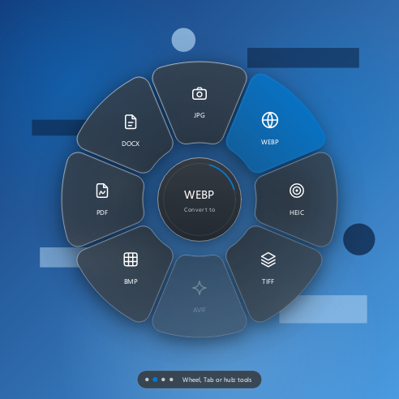
  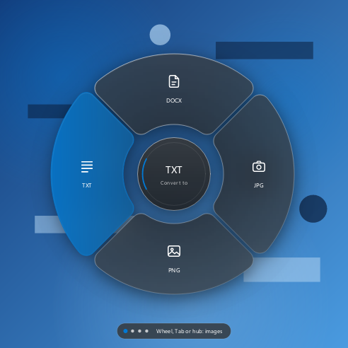
  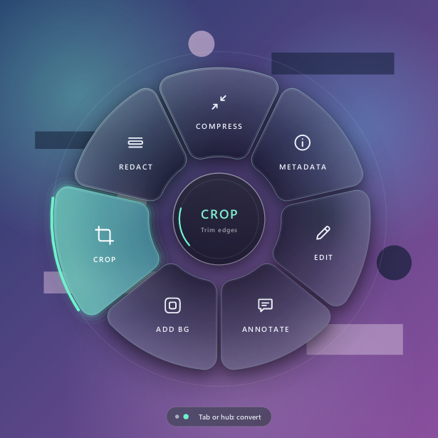
  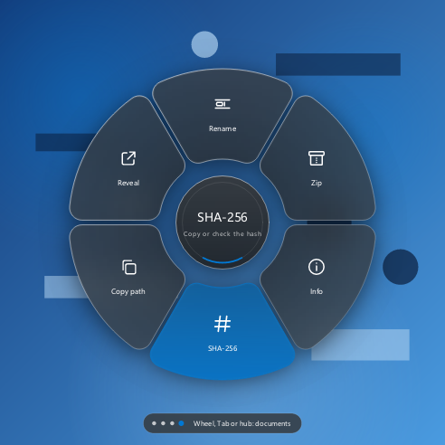
</p>

## What it does

Every file you drag gets the **rings that apply to it**. Radial looks inside the file (not just at its name) to decide
which ones, and which opens first.

| Ring | What is in it | Which files have it |
| --- | --- | --- |
| **Documents** | Convert to DOCX, TXT, PDF, CSV, XLSX, JPG, PNG | pictures, PDF, Word, text, CSV, workbooks |
| **Images** | Convert to PNG, WEBP, HEIC, TIFF, AVIF, BMP, JPG (and PDF, DOCX for a picture) | the same files |
| **Tools** | What only that kind of file has: a picture's eight tools, a PDF's copy text and split | pictures, PDF |
| **Files** | What works on any file, always in the same order | every file, folders and ZIPs included |
| **Yours** | Your own sectors (see below) | when you made some that fit the files |

**Turn the mouse wheel while you drag** to walk through the rings (down is next, up is previous; Tab and resting on the
hub also go to the next one). The pill under the ring shows one dot per ring and what comes next. A ring with nothing
in it for your files is skipped, so you never scroll through dead rings, and the wheel is left alone when there is only
one. The hub shows the file size and format.

Results are written next to the original (or into your output folder) and **never overwrite anything** unless you
choose "Overwrite": `photo.png` becomes `photo (1).png`. Dragging several files runs the action on all of them.

### Sectors that cannot work are shown, not hidden

A sector is only drawn when something can work for your files. When it can in general but not here, it is greyed out
and hovering it says why in the pill under the ring: `AVIF encoding needs ...` when Windows has no AV1 encoder,
`Works on JPG, PNG, WEBP only` for COMPRESS on a BMP, `Works on files, not folders` for SHA-256 on a folder,
`Drop a single image to use this` for the editors. `radial --formats` prints exactly what your machine can read and write.

<p align="center">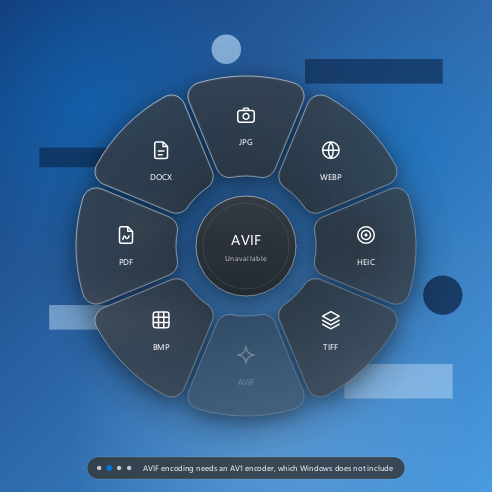</p>

### Convert (Documents and Images rings)

| You drag | You can get |
| --- | --- |
| **A picture** (PNG, JPG, WEBP, GIF, TIFF, BMP, HEIC, AVIF) | any other picture format, PDF, DOCX, **TXT** (reads the text with Windows OCR) |
| **A PDF** | JPG, PNG, WEBP... (one picture per page), TXT, DOCX |
| **A Word file** (.docx) | PDF, TXT, any picture format |
| **A text file** (txt, md, log, json, xml, yaml, ini) | PDF, DOCX, any picture format |
| **A workbook** (.xlsx) | **CSV** (one per sheet; dates stay dates; cells that start like a formula get a leading apostrophe so Excel cannot run them), TXT, PDF, pictures |
| **A CSV or TSV** | **XLSX**, PDF, pictures |
| **Several files that can all be a PDF** | **MERGE**: one PDF, in natural order (`file2` before `file10`) |

### Tools ring

| Sector | What happens |
| --- | --- |
| **COPY TEXT** (picture or PDF) | Reads the text of a picture with Windows OCR, or a PDF's text layer (OCR for scans), and puts it on the clipboard. Several files are separated by their names. |
| **RESIZE** (pictures, any number) | A small dialog with big presets: Email 1600 px, Web 1280, Phone 1080, Small 640, Half, Quarter, or your own size. Shows each result and an estimate of the file size before you click. Never upscales, drops EXIF and GPS, JPG option for PNGs. |
| **COMPRESS** | Runs on drop. JPEG is re-encoded at quality 80, PNG (smaller palettes or colour types, maximum deflate) and WEBP are lossless. A file is only written when it is smaller. The notice shows before and after sizes. |
| **METADATA** | Runs on drop. Removes EXIF (camera, GPS location), XMP, IPTC and text chunks and saves `name (clean).ext`. A picture without metadata writes nothing. |
| **CROP** | Dialog: ratio Free, 1:1, 16:9, 9:16, 4:3, 3:4; a rectangle you drag with eight handles; W and H in pixels. |
| **EDIT** | Dialog: rotate, flip, resize (with or without keeping proportions), grayscale, brightness, contrast, with a live preview. |
| **ANNOTATE** | Dialog: pen, line, arrow, box, ellipse, marker, text; colour, size, undo. A filled black box is how you black something out: the saved copy has those pixels replaced, not covered. |
| **ADD BG** | Dialog: ten gradients and colours, your own colour or a picture as background; Padding, Corners and Shadow sliders; canvas ratio Auto, 1:1, 16:9, 4:5. |
| **SPLIT** (PDF) | One PDF per page in a new folder `name pages`. Text stays text, fonts and vector art are copied untouched. Links, bookmarks and the document properties are dropped on purpose (privacy); typed values in form fields are not kept. |

### Files ring (works on any file)

| Sector | What happens |
| --- | --- |
| **RENAME** | Dialog with a live preview of every new name: find and replace, case, spaces, remove accents, prefix and suffix, numbering, date (modified, created or EXIF taken), lowercase extension. Conflicts are shown in red and block the button; nothing is ever overwritten. Works on thousands of files at once. |
| **ZIP** | Packs files and folders into one `.zip`, streaming (constant memory; up to 4 GiB and 65,534 entries). Already-compressed files (JPG, MP4, ZIP...) are stored, not deflated again. A file that is in use or unreadable is left out and the notice says how many. |
| **INFO** (files) | Name, type, size, dates, and for Word, Excel and PowerPoint the author, last editor, company and pages; for PDF the title, author, producer and pages. Also copied to the clipboard. |
| **SHA-256** (files) | Copies the file's hash. If the clipboard already holds a hash (from a download page, or `sha256sum` output) it **verifies** instead and tells you whether they match, leaving your clipboard alone. |
| **COPY PATH** | The full path on the clipboard (one per line for several files). |
| **REVEAL** | Opens Explorer with the file selected. |
| **UNZIP** (ZIPs only) | Extracts next to the archive into a folder of its own. Refuses `..` paths, absolute paths, device names, links and zip bombs (judged per entry and for the whole archive); never overwrites; removes what it extracted if anything is wrong. |
| **SORT** (folders only) | Asks "by type or by month?" and moves the loose files into subfolders. Subfolders, unknown file types, hidden files and half-downloaded files stay where they are. Nothing is overwritten. |

**Undo.** Rename, Sort and the moves of your own sectors write what they did to a log; the tray menu has **Undo last
rename or sort**. Files that changed or vanished since are left alone and counted, and the folders a sort made go
again if they are empty.

### Your own sectors

In **Settings > My sectors** you make drop zones of your own and they show up as their own ring when they fit the files
you drag:

- **Move to a folder** ("Invoices" for your PDFs), **copy to a folder** ("USB"), or **open with a program** ("Editor").
- Optional extensions: a sector for `pdf, docx` only appears when you drag only those.
- Moves never overwrite (`name (1).ext`), work across drives, and are covered by Undo.

They live in `%APPDATA%\radial\sectors.txt`, one per line, in plain text you can edit or copy to another machine.

<p align="center">
  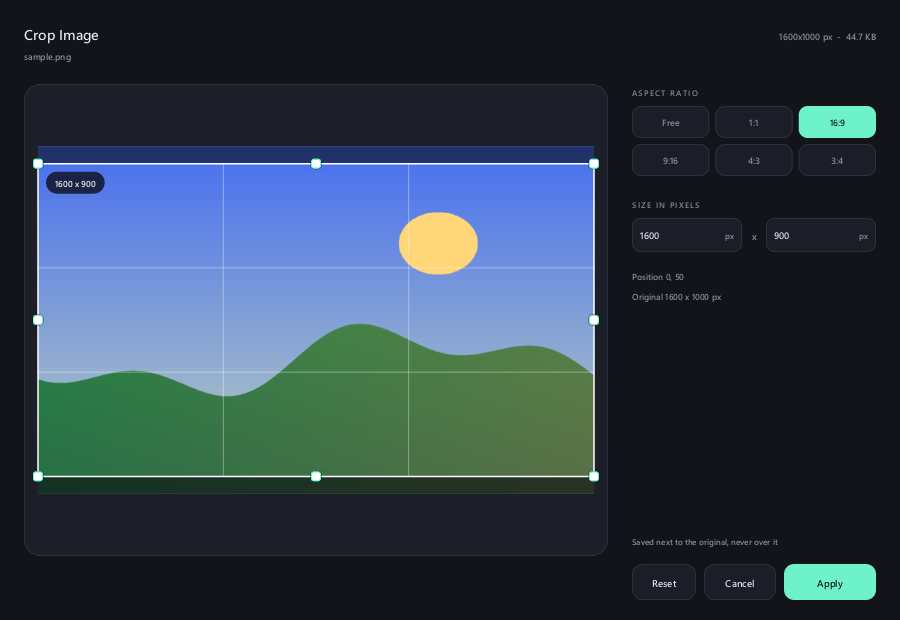
  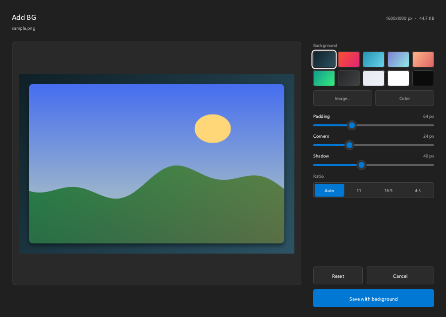
  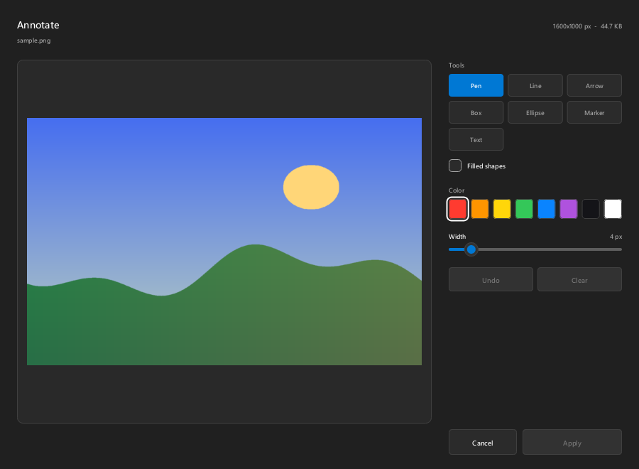
  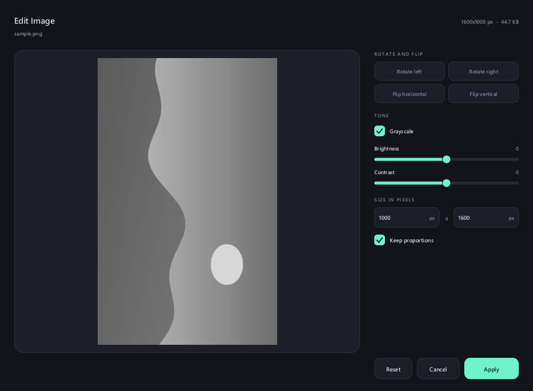
</p>

The dialogs are drawn by the app itself in the Windows 11 look (system light or dark, system accent colour, 4 px
controls), keyboard friendly (**Tab** moves between controls, **Enter** applies, **Esc** closes, **Ctrl+Z** undoes in
ANNOTATE), and DPI aware. They are created when you drop and every buffer is freed when they close. The heavy work
(decoding, previews, saving) runs on worker threads, so a large picture never freezes the window.

## Looks

- **It looks like Windows.** The default theme, "Windows 11", is flat acrylic with the system accent colour and follows
  light or dark mode; the dialogs and Settings use the same neutrals, 4 px controls and Segoe UI.
- **Seven more themes, and yours.** Obsidian Glass (real frosted glass), Frosted Paper, Mono Ink, Aurora, Sunset,
  Terminal Neon and Noir Gold. A theme is a plain text file (see [Themes](#themes)).
- **A configurator with a live preview.** The first run starts a three step onboarding (pick a look, pick a key,
  done); afterwards it is one click away in the tray menu. Everything is adjustable: accent colour, size, ring
  thickness, gap, corner roundness, glass strength, animation speed, font, trigger key (Shift, Ctrl, Alt or none),
  open delay, output folder, what to do when the name is taken, sound or notification when done, how to switch rings,
  which ring opens first, start with Windows, English or Spanish.

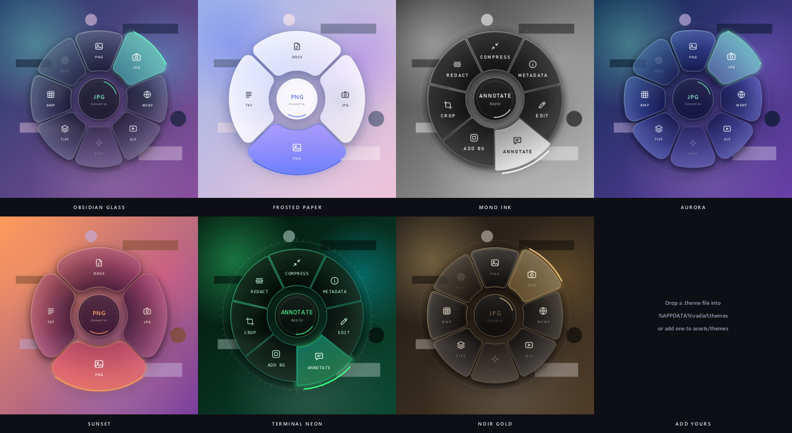

<p align="center">
  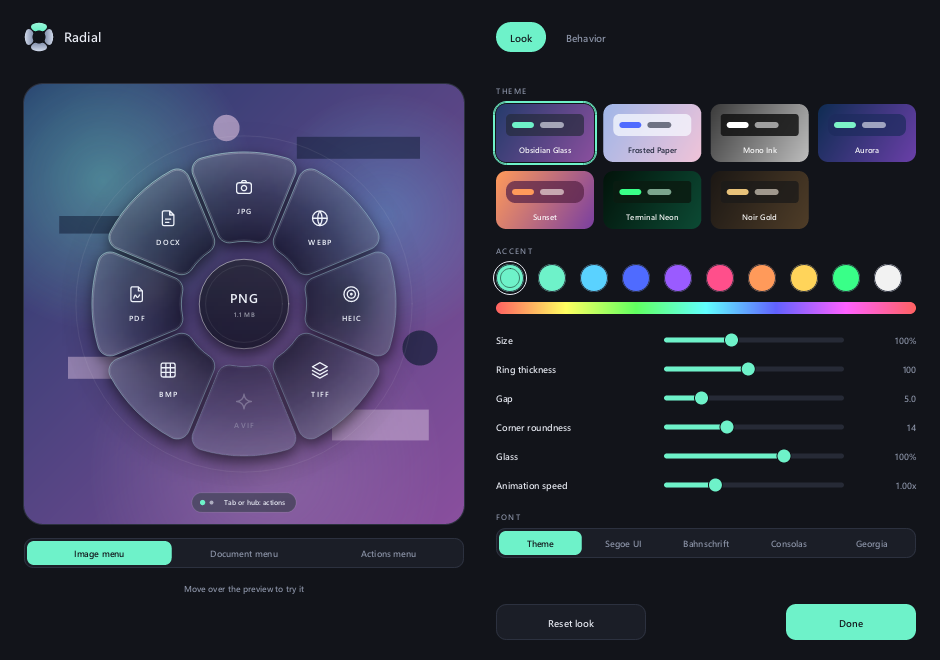
  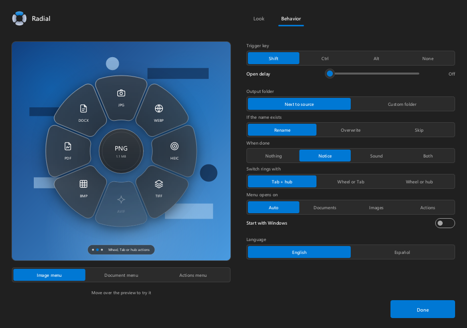
</p>

## Formats

`radial --formats` prints this table for your machine. What each format needs:

| Format | Read | Write | How, and what to know |
| --- | --- | --- | --- |
| PNG, JPG, BMP, TIFF | yes | yes | Pure Rust. JPG output flattens transparency onto white. The EXIF orientation is applied when reading. |
| WEBP | yes | yes | Pure Rust, output is **lossless**. |
| GIF | yes | no | First frame only: animations become a still picture. No sector writes GIF. |
| HEIC | needs Windows | needs Windows | Through the Windows codec ("HEIF Image Extensions" from the Microsoft Store). Without it the sector is greyed out and says so. |
| AVIF | needs Windows | **off by default** | Reading needs the Store's "AV1 Video Extension". Windows ships no AVIF encoder, so the sector is greyed out unless you build with `--features avif-encode` (pure-Rust rav1e, about +2.3 MB and slow on big pictures). |
| PDF | yes | yes | Pages are rendered with the Windows PDF engine (`Windows.Data.Pdf`); text comes from the text layer, or from Windows OCR for scans. Merge and split copy the real content byte for byte. Password-protected PDFs are refused, including ones that only have an owner password. |
| DOCX | yes | yes | Text, page breaks and pictures. Word opens the result; other editors were not tested. Layout and styles are not kept. |
| XLSX | yes | yes | Reads shared and inline strings, dates (1900 and 1904 systems), percentages and cached formula values; hidden sheets are skipped; up to 5 million cells. Old `.xls` and password-protected files are refused with a clear message. Writing produces a clean workbook (no personal data) that Excel, LibreOffice and pandas open. |
| CSV, TSV | yes | yes | Out: UTF-8 with BOM and **your Windows list separator** (`;` in much of Europe and Latin America), which is what makes Excel open it in columns. In: the delimiter (`,` `;` tab `|`) is detected. |
| TXT | yes | yes | UTF-8, UTF-16 with a BOM or Windows-1252 are detected. |
| ZIP | yes | yes | Stored and deflate, no encryption, no zip64 (4 GiB and 65,534 entries per archive). |

Reading text out of pictures uses the OCR languages of your Windows profile (Settings > Time & language). Without one,
the sector is greyed out and says so.

## Install

Download `radial.exe` (or the zip with the licence) from the releases page and run it. It lives in the tray (right
click for the menu). There is no installer; delete the file and `%APPDATA%\radial` to remove it.

### Build

```
cargo build --release
```

The binary is `target/release/radial.exe`. Fonts are read from the Windows fonts folder (Segoe UI Variable,
Bahnschrift, Consolas, Georgia), nothing is bundled. Optional: `cargo build --release --features avif-encode` adds an
AVIF encoder.

## Using it

1. Run `radial.exe`. On first run the onboarding opens.
2. Start dragging a file from Explorer or the desktop.
3. Hold the trigger key (Shift by default), turn the **mouse wheel** (or press Tab, or rest on the centre) to find the
   ring you want, move onto a sector and let go.

Tray menu: **Settings...**, **Pause / Resume**, **Start with Windows**, **Undo last rename or sort**, **About**,
**Quit**. Double click the tray icon to open the settings.

Command line (all optional, for scripting, documentation and development):

| Flag | What it does |
| --- | --- |
| `--help`, `--version` | Prints usage or the version |
| `--formats` | Prints what this machine can read and write |
| `--open crop\|bg\|edit\|annotate <image>` | Opens one action dialog without the tray; the process ends when it closes |
| `--autostart on` / `--autostart off` | Adds or removes the start-with-Windows entry (`HKCU\...\Run`) and exits |
| `--preview out.png [--theme glass] [--hover 2] [--menu 8\|4\|7\|6] [--accent #ff8800] [--dpi 2]` | Renders a menu over a sample wallpaper: 8 is the images ring of a PNG, 4 the documents ring of a PDF, 7 the tools ring of a PNG, 6 the files ring |
| `--sheet out.png` | Renders every theme into one contact sheet (this is how `docs/themes.png` is made) |
| `--settings out.png [--tab 0..2] [--step 0..2] [--lang es] [--light] [--menu 8\|4\|7]` | Renders the configurator window to a PNG |
| `--dialog crop\|bg\|edit\|annotate\|resize\|rename\|sector --out out.png [--image f] [--script s] [--lang es] [--light] [--dpi 2]` | Renders a dialog to a PNG; `--script "click:102;drag:200,300,420,230;text:Hi;key:13"` drives it first (this is how the `docs/dialog-*.png` are made) |
| `--tray-icon out.png [--size 256]` | Renders the icon at any size (the `.ico` is built from it) |
| `--bench [--theme x] [--dpi 1.2]` | Prints the time to bake and render a frame |

## Settings file

`%APPDATA%\radial\config` is a `key = value` text file the configurator rewrites; you can edit it by hand (unknown
keys and bad values are ignored, numbers are clamped).

| Key | Values | Default |
| --- | --- | --- |
| `theme` | a theme name | `windows` |
| `accent` | `auto` or `#rrggbb` | `auto` |
| `size` | 0.7 to 1.5 | `1` |
| `ring`, `gap`, `corner` | ring thickness 56 to 150, gap 0 to 24, corner 0 to 40 (logical px) | from the theme |
| `glass` | 0 (plain tint) to 1.5 (strong blur) | `1` |
| `speed` | animation speed 0.4 to 2.5 | `1` |
| `font` | `theme`, `variable`, `bahnschrift`, `consolas`, `georgia` | `theme` |
| `trigger` | `shift`, `ctrl`, `alt`, `none` | `shift` |
| `delay_ms` | 0 to 800, how long the drag is held before the menu opens | `0` |
| `ring_switch` | `both` (Tab or resting on the hub), `tab`, `hub`; the wheel always works | `both` |
| `start_ring` | `auto` (pictures on the images ring, everything else on documents), `documents`, `images`, `tools` or `files`: the ring a drag opens on, when the file has it | `auto` |
| `out_dir` | empty (next to the source) or a folder | empty |
| `collision` | `rename`, `overwrite`, `skip` | `rename` |
| `notify` | `off`, `balloon`, `sound`, `both` | `balloon` |
| `autostart` | `true` / `false` | `false` |
| `lang` | `en`, `es` | system language |

## Themes

A theme is a `key = value` file; every key is optional and defaults to the Obsidian Glass values. The built-in ones live in
[`assets/themes`](assets/themes) and are embedded in the binary. Your own go in `%APPDATA%\radial\themes\*.theme` and
show up in the configurator next to the built-in ones.

```
# my-theme.theme
name = my-theme            # lowercase letters, digits and - only
label = My Theme
accent = #ff8a3d
accent2 = #ff3d81          # second colour of the accent gradient
glass_top = #3a2f4aa0      # tint at the outer edge, #rrggbbaa: alpha is how much of the frosted backdrop it hides
glass_bottom = #120d1ac8   # tint at the inner edge
ring = 96
gap = 4
corner = 18
weight = 500
stiffness = 220            # spring stiffness, higher is snappier
damping = 0.6              # below 1 overshoots, above 1 is sluggish
```

Colours are `#rgb`, `#rrggbb` or `#rrggbbaa`. The full key list, with ranges, is in
[`src/theme.rs`](src/theme.rs) (`Theme::set` and `Theme::validate`); an invalid file is skipped and
`radial --preview out.png --theme my-theme` shows the result without touching your settings. To ship a theme with
the app, drop the file into `assets/themes` and list it in `BUILTIN`. The `windows` theme is special: it takes the
light or dark mode and the accent colour from Windows (see `windows_variant` in `src/theme.rs`).

## How it works

- Low-level mouse and keyboard hooks feed a small state machine (`src/trigger.rs`) that spots "left button dragged,
  trigger key held". Nothing else runs while idle. While a menu is up the keyboard hook also turns Tab, and the mouse
  hook the wheel, into the ring switch; the wheel is only taken when there is another ring to go to.
- The menu is a topmost, non-activating layered window with a per-pixel-alpha bitmap and an OLE drop target, so it
  receives the drop like any other window. Its buffers only exist while the menu is on screen. The whole interactive
  disc stays faintly opaque so a drag never falls through the window while the sectors animate.
- `src/engine` is a UI-free library: content-based type detection, conversions (`pipeline.rs`), spreadsheets
  (`xlsx.rs`), PDF merge and split (`pdftools.rs`), the picture tools, rename planning (`rename.rs`), folder sorting
  (`sortdir.rs`) and the file operations (`fileops.rs`: streaming zip and unzip, SHA-256, properties). It never
  overwrites a file, writes through a temporary file, and caps what it decodes (100 megapixels, 30 000 px a side,
  512 MB of input, 5 million cells). Windows codecs (PDF rendering, OCR, HEIC, AVIF) go through WinRT, so no codec DLL
  ships with the app.
- `src/ring.rs` decides which rings a set of files has, which sectors each holds and which are usable; `src/menus.rs`
  turns that into labels, hub text and the caption pill. Both are pure and unit tested, and the live overlay and the
  previews share them. `src/universal.rs` runs the actions that work on any file and `src/sectors.rs` your own.
- Rendering (`src/render.rs`) is software, with [tiny-skia](https://github.com/RazrFalcon/tiny-skia). The frosted
  glass, tint, light and shadows are baked once when a menu opens, so a frame only copies them through the sector
  shapes and draws the lit parts, the icons and the text.
- The dialogs (`src/dialogs`) are one small immediate-mode toolkit (`ui.rs`) plus one file per dialog. The crop
  rectangle maths, the edit state and the annotation tools are pure and unit tested (`geom.rs`).
- Hit-testing and corner geometry are pure math (`src/geometry.rs`); themes (`src/theme.rs`) and settings
  (`src/config.rs`) are plain data with unit tests.

### Performance

Measured on the release build (Windows 11, one machine, so treat the numbers as a guide):

| | |
| --- | --- |
| Executable | 4.4 MB (LTO, `opt-level = 3`, no codec DLLs) |
| Idle CPU | 0 ms over 20 seconds (only two hooks and the tray icon are alive) |
| Idle memory | about 2 MB private (14 MB working set, mostly shared Windows pages) |
| A dialog open on a 3000 x 2000 picture | 15 to 26 MB private, back to the idle figure within 1 MB after it closes |
| Menu frame | 2.4 ms at 100% scale (`radial --bench`); baking the glass when a menu opens takes 2 to 5 ms |
| 3000 x 2000 PNG to JPG, WEBP, PDF | about 150 ms, 55 ms, 280 ms |
| Zip, unzip, SHA-256 | about 380, 1,280 and 340 MB/s, constant memory (a few MB) whatever the size |
| Merge 20 PDFs (940 pages), split them again | 7 ms, 14 ms |
| Shrink a 24 megapixel photo to 1600 px | about 180 ms; 20 photos of 12 MP in under a second |
| Read a 200,000 row workbook | about 0.7 s (transient peak of a few hundred MB while it is read) |

## Limits

- Drags are only recognised when they start over an Explorer window or the desktop.
- Windows probably blocks drops from elevated (admin) windows onto a normal process (UIPI); not tested. Run Radial
  elevated too if you need that.
- The glass is a snapshot of the screen taken when the menu opens, not a live blur: Windows' acrylic and
  blur-behind effects cannot follow the shape of a per-pixel-alpha layered window (they blur the whole rectangle).
  Anything that moves behind the menu while it is open does not show through.
- The picture editors (crop, edit, annotate, add background) work on one image at a time; resize, rename, compress,
  metadata and the conversions take any number. They read the first frame of animated GIFs and save a still picture.
- The menu is built from the first 200 files of a very large drag; the rest are handled (and refused one by one when
  they do not fit) when the action runs.
- PDF to DOCX keeps the text, not the layout; a table too long for a PDF (over 20,000 rows) is refused and points to CSV.
- A PDF whose fonts have no text map (some generated by reportlab or old tools) gives no text layer, so COPY TEXT and
  PDF to TXT read it with Windows OCR, which is slower and less exact.
- A workbook is refused when it holds more than 5 million cells or 256 MB of text, a file when it is over 512 MB, and
  merging stops at 1 GB of input.
- If Radial ever hits a bug with a file it stops that job, tells you, and writes the details to
  `%APPDATA%
adial\crash.log` (attach it to a bug report); the rest of the program keeps running.
- Sector and dialog texts are English and Spanish; the reasons Windows codecs give for being unavailable are in
  English.
- Windows 11 is the target; the tray menu, settings window and drag handling use only long-standing Win32 calls.

## Contributing and license

See [CONTRIBUTING.md](CONTRIBUTING.md) and the [changelog](CHANGELOG.md). MIT, see [LICENSE](LICENSE).
